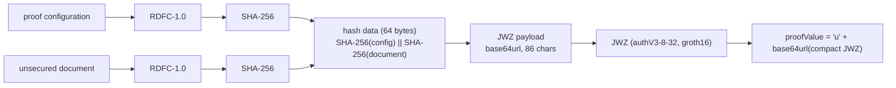

# iden3-jwz-rdfc-2026 Data Integrity Cryptosuite

# Summary

`iden3-jwz-rdfc-2026` is a [W3C Data Integrity](https://www.w3.org/TR/vc-data-integrity/) cryptosuite that secures a JSON-LD document (for example a DID document, a DID configuration or a verifiable credential) with a [JSON Web Zero-knowledge (JWZ)](../jwz/overview.md) token instead of a digital signature.

It follows the steps of the W3C suite [`ecdsa-rdfc-2019`](https://www.w3.org/TR/vc-di-ecdsa/#ecdsa-rdfc-2019): the document and the proof options are canonicalized with [RDF Dataset Canonicalization (RDFC-1.0)](https://www.w3.org/TR/rdf-canon/) and hashed with SHA-256. The resulting hash is then proven with an iden3 authentication circuit, wrapped in a JWZ, instead of being signed with an ECDSA key.

With this suite an iden3 identity can sign a document with its authentication key (a BabyJubJub key in its claims tree), without publishing that key: the verifier checks a zero-knowledge proof that the identity holds a valid authentication key in a state that is recorded on chain, in the Global Identity State Tree (GIST).

This document is a draft and is open for public review and feedback. The name `iden3-jwz-rdfc-2026` is a working name. Only the value of `cryptosuite` depends on it.

# Terminology

**secured document** - a JSON-LD document with a `proof` member that holds a proof of this suite.

**unsecured document** - the secured document without its `proof` member.

**proof options** - the proof object without its `proofValue` member.

**proof configuration** - the proof options, with the `@context` of the unsecured document added as their `@context`.

**profile** - the specification of an application that uses this suite. A profile sets the documents it secures, the DID that is expected to sign each of them, and the bounds of a proof's lifetime (`created` to `expires`).

**compact JWZ** - the compact serialization of a JWZ token: `BASE64URL(header) '.' BASE64URL(payload) '.' BASE64URL(zkp)`.

**GIST** - Global Identity State Tree, the tree of the State contract that holds the latest state of every iden3 identity. See [GIST](https://docs.iden3.io/protocol/spec/#gist-new).

# The proof object

A proof is one JSON object, not a list, with exactly these members, all strings:

| Member               | Value                                                                                                                       |
|----------------------|-----------------------------------------------------------------------------------------------------------------------------|
| `type`               | `DataIntegrityProof`                                                                                                        |
| `cryptosuite`        | `iden3-jwz-rdfc-2026`                                                                                                       |
| `created`            | a UTC date and time in whole seconds, `YYYY-MM-DDThh:mm:ssZ`                                                                |
| `expires`            | the same form, later than `created`                                                                                         |
| `verificationMethod` | `<did>#state-info`, where `<did>` is the signer that the document names: the DID document's `id`, or the credential's `issuer` |
| `proofPurpose`       | `assertionMethod`                                                                                                           |
| `proofValue`         | `u`, then the compact JWZ, base64url-encoded without padding (see [Creating a proof](#creating-a-proof))                     |

- Every member is a term of the Data Integrity context `https://w3id.org/security/data-integrity/v2`, which the `@context` of the secured document MUST list. The proof has no `@context` of its own, and no `id`, `challenge`, `domain`, `nonce` or `previousProof`.
- The profile sets the lifetime from `created` to `expires`.
- `<did>#state-info` is the `Iden3StateInfo2023` verification method of an iden3 DID. It is not a key, so a verifier does not look for it under the `assertionMethod` of the DID document. The authority to sign comes from the proof itself: it shows that the identity of `<did>` holds an authentication key in a state recorded on chain (see [Verifying a proof](#verifying-a-proof), steps 8 and 9).

Example of a secured DID document. The DID is illustrative, and the `proofValue` is shortened: it shows only the encoding of the `authV3-8-32` header and the first dot.

```json
{
  "@context": [
    "https://www.w3.org/ns/did/v1",
    "https://w3id.org/security/data-integrity/v2"
  ],
  "id": "did:iden3:polygon:amoy:x6x5sor7zpyZX9yNpm8h1rPBDSN9idaEhDj1Qm8Q9",
  "service": [
    {
      "id": "did:iden3:polygon:amoy:x6x5sor7zpyZX9yNpm8h1rPBDSN9idaEhDj1Qm8Q9#linked-domain",
      "type": "LinkedDomains",
      "serviceEndpoint": "https://example.com"
    }
  ],
  "proof": {
    "type": "DataIntegrityProof",
    "cryptosuite": "iden3-jwz-rdfc-2026",
    "created": "2026-11-16T10:00:00Z",
    "expires": "2026-11-30T10:00:00Z",
    "verificationMethod": "did:iden3:polygon:amoy:x6x5sor7zpyZX9yNpm8h1rPBDSN9idaEhDj1Qm8Q9#state-info",
    "proofPurpose": "assertionMethod",
    "proofValue": "uZXlKaGJHY2lPaUpuY205MGFERTJJaXdpWTJseVkzVnBkRWxrSWpvaVlYVjBhRll6TFRndE16SWlMQ0pqY21sMElqcGJJbU5wY21OMWFYUkpaQ0pkTENKMGVYQWlPaUpoY0hCc2FXTmhkR2x2Ymk5cFpHVnVNeTE2YTNBdGFuTnZiaUo5Lg..."
  }
}
```

# Circuits and the JWZ header

The allowed circuits, with the exact protected header of each:

| Circuit       | Protected header (UTF-8 bytes)                                                                         |
|---------------|--------------------------------------------------------------------------------------------------------|
| `authV3-8-32` | `{"alg":"groth16","circuitId":"authV3-8-32","crit":["circuitId"],"typ":"application/iden3-zkp-json"}` |

- The header is exactly these bytes: the members in this order, with no whitespace. It is what [go-jwz](https://github.com/iden3/go-jwz) and [js-jwz](https://github.com/iden3/js-jwz) write, with the `typ` that the ZKP packer of the [js-sdk](https://github.com/0xPolygonID/js-sdk) sets.
- go-jwz and js-jwz compute the challenge from the parsed header serialized again with sorted keys, not from the bytes in the token. So a header that differs in spacing, key order or escaping still verifies with those libraries alone. A header with a nested object is even serialized differently by the two libraries, because js-jwz drops nested members its key list does not name. A fixed header per circuit makes the token unambiguous, and the result the same in Go and TypeScript.
- A new circuit is added by amending this table. The secured documents and their contexts do not change.

# Hashing

Creating and verifying a proof both compute the JWZ payload from the secured document:

1. Split the secured document into the unsecured document, without its `proof` member, and the proof options, which are the proof object without `proofValue`.
2. Build the proof configuration: the proof options, with the `@context` of the unsecured document added as their `@context`.
3. Canonicalize the proof configuration and the unsecured document separately, with RDF Dataset Canonicalization (RDFC-1.0, also called URDNA2015), into canonical N-Quads:
    - processing follows JSON-LD 1.1;
    - contexts come only from local copies bundled with the implementation, with no network request, and any other context is an error;
    - nothing may be dropped: a member that is not a term of the contexts, a relative IRI, or any other value that would not reach the N-Quads is an error. The document is then rejected, not hashed without it.
4. The hash data is the SHA-256 of the canonical proof configuration followed by the SHA-256 of the canonical unsecured document: 64 bytes, in that order, as in `ecdsa-rdfc-2019`.
5. The JWZ payload is the hash data, base64url-encoded without padding: 86 ASCII characters. It is text rather than the 64 raw bytes, because js-jwz carries a payload as a UTF-8 string, which arbitrary bytes do not survive.

The hash covers every member of the document and of the proof options, `cryptosuite` and `expires` included. A proof therefore cannot be moved to another document, to another kind of document, or to other dates.

# Creating a proof

The holder of the identity (usually its wallet) creates the proof:

1. Build the proof options of [The proof object](#the-proof-object), without `proofValue`. `created` is the current time, and `expires` follows the profile.
2. Compute the payload (see [Hashing](#hashing)).
3. Make a JWZ over the payload, as the identity of `<did>`, with a circuit of [Circuits and the JWZ header](#circuits-and-the-jwz-header) and its exact header. The circuit's challenge is the JWZ message hash, as go-jwz and js-jwz compute it (see [JWZ, algorithm for message hash generation](../jwz/overview.md#algorithm-for-message-hash-generation)): the SHA-256 of `BASE64URL(header) || '.' || BASE64URL(payload)`, read as a little-endian integer, reduced modulo the BN254 scalar field, then hashed with Poseidon. No other mapping from the document's hash to the challenge applies. The proof uses the GIST root that the State contract holds as its latest when proving.
4. Serialize the JWZ in its compact form, `BASE64URL(header) '.' BASE64URL(payload) '.' BASE64URL(zkp)`, without padding. `zkp` is the JSON object with exactly the members `proof` and `pub_signals`.
5. Set `proofValue` to `u` followed by the bytes of the compact JWZ, base64url-encoded without padding. Data Integrity requires a [multibase](https://datatracker.ietf.org/doc/html/draft-multiformats-multibase) value, and the dots of the compact form are not in the base64url alphabet.



# Verifying a proof

The inputs are:

- the secured document;
- the DID that the profile expects as the signer;
- the verifier's time, `now`;
- for each DID network the verifier accepts, the State contract and a way to read it;
- the verification key of each circuit of [Circuits and the JWZ header](#circuits-and-the-jwz-header), bundled with the implementation;
- the profile's lifetime bounds.

The steps run in this order. The first failure rejects, with the reason given (see [Rejection reasons](#rejection-reasons)), and a step that cannot be completed rejects. Steps 1 to 8 are local; step 9 is the only one that uses the network.

1. **Shape**: the document has one `proof`, an object of exactly the form of [The proof object](#the-proof-object), whose `verificationMethod` is `<expected DID>#state-info`. Otherwise `proof_malformed`.
2. **Dates**: `created` is at most 5 minutes after `now`, and the time from `created` to `expires` lies within the profile's bounds. Otherwise `proof_malformed`. `now` is before `expires`. Otherwise `proof_expired`.
3. **Decoding**: `proofValue` starts with `u`, and the rest is base64url without padding, in canonical form: encoding the decoded bytes again gives the same text. The decoded bytes are ASCII, and split at `.` into exactly three segments, each non-empty canonical base64url without padding. Otherwise `proof_malformed`.
4. **Header**: the first segment decodes to exactly the header of one circuit of [Circuits and the JWZ header](#circuits-and-the-jwz-header). Otherwise `proof_malformed`.
5. **Hash**: the second segment decodes to exactly the payload of [Hashing](#hashing), computed from this document and this proof. Otherwise `proof_hash_mismatch`. A document that cannot be canonicalized (Hashing, step 3) is rejected with `document_malformed`.
6. **Proof form**: the third segment decodes to a JSON object with exactly `proof` and `pub_signals`. `pub_signals` holds the circuit's public signals as decimal field elements: for `authV3-8-32`, `userID`, `challenge` and `GISTRoot`. Otherwise `proof_malformed`.
7. **Zero-knowledge proof**: the `challenge` signal equals the JWZ message hash (Creating a proof, step 3), and the groth16 proof verifies with the circuit's verification key. Otherwise `proof_invalid`. go-jwz's `Token.Verify` and js-jwz's `verify` check both.
8. **Signer**: the `userID` signal is the iden3 identifier of the expected DID. Otherwise `proof_signer_mismatch`. For a profile DID (an identity profile derived with a nonce), the circuit outputs the profile's identifier, so this holds for the profile's DID.
9. **State**: the DID's network is one the verifier accepts, and its State contract knows the `GISTRoot` signal as a GIST root (`getGISTRootInfo`). Otherwise `proof_invalid`. If that root has since been replaced, its `replacedAtTimestamp` is no earlier than 5 minutes before `created`. Otherwise `state_superseded`. When the State contract cannot be read (no answer, a timeout, a transport error, or an answer that is not a contract result), the proof is rejected with `state_unavailable`.

The proof then verifies.

## The state check

Step 9 compares the replacement time of the GIST root with `created`, not with `now`: it shows that the root was current when the proof was made, and gives the same result whenever it runs. How long a proof is accepted after `created` is bounded by step 2, through `expires` and the profile's lifetime, not by this step.

With the iden3 authentication libraries ([go-iden3-auth](https://github.com/iden3/go-iden3-auth), [js-iden3-auth](https://github.com/iden3/js-iden3-auth)), step 9 is their GIST check with `acceptedStateTransitionDelay` set to `now − created + 5 minutes`. Their check compares the replacement time with `now`; this delay moves the comparison to `created`. A fixed delay is wrong at any time: the default of 5 minutes would reject documents a few minutes after they were signed, and a delay as long as the lifetime would accept a root replaced long before `created`.

A verifier that issued the request for the document (for example a registration challenge) can also check that `created` is recent, because it knows when it issued the request. A later verifier cannot, and relies on the signed `created`, which step 2 bounds: at most 5 minutes ahead of `now`, and at most the profile's longest lifetime before `expires`.

## What verification does not check

- Whether the identity changed its state after `created`, for example to revoke the authentication key. The document stays valid until it expires, so the profile's lifetime bounds how long a superseded document is accepted.
- The identity's own state: the circuit proves that the state is in the GIST root, and step 9 checks the root.
- `proofValue` as a value: groth16 proofs can be re-randomized, so a document can carry more than one valid `proofValue`. Nothing may use `proofValue` as an identifier.

# Rejection reasons

Implementations report the failure of a proof with these reasons:

| Reason                  | Steps of verification | Can a retry succeed?         |
|-------------------------|-----------------------|------------------------------|
| `proof_malformed`       | 1, 2, 3, 4, 6         | No                           |
| `proof_expired`         | 2                     | No; the holder signs again   |
| `document_malformed`    | 5                     | No                           |
| `proof_hash_mismatch`   | 5                     | No                           |
| `proof_invalid`         | 7, 9                  | No                           |
| `proof_signer_mismatch` | 8                     | No                           |
| `state_superseded`      | 9                     | No; the holder signs again   |
| `state_unavailable`     | 9                     | Yes                          |

# References

- [JSON Web Zero-knowledge (JWZ)](../jwz/overview.md)
- [Verifiable Credential Data Integrity 1.0](https://www.w3.org/TR/vc-data-integrity/)
- [Data Integrity ECDSA Cryptosuites, `ecdsa-rdfc-2019`](https://www.w3.org/TR/vc-di-ecdsa/#ecdsa-rdfc-2019)
- [RDF Dataset Canonicalization (RDFC-1.0)](https://www.w3.org/TR/rdf-canon/)
- [go-jwz](https://github.com/iden3/go-jwz), [js-jwz](https://github.com/iden3/js-jwz)
- [go-iden3-auth](https://github.com/iden3/go-iden3-auth), [js-iden3-auth](https://github.com/iden3/js-iden3-auth)
- [iden3 circuits](https://docs.iden3.io/protocol/main-circuits/)
